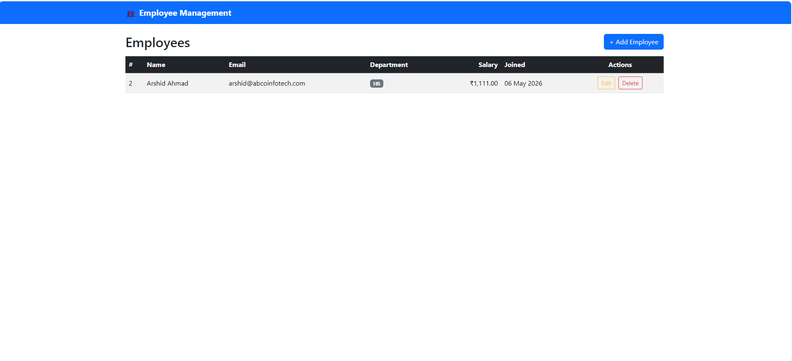
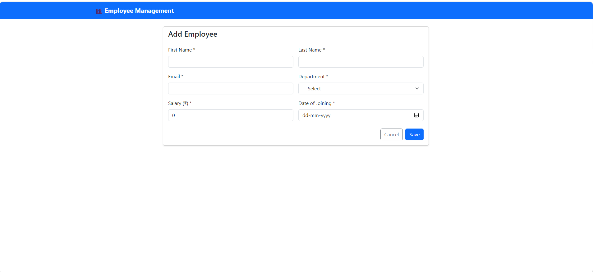
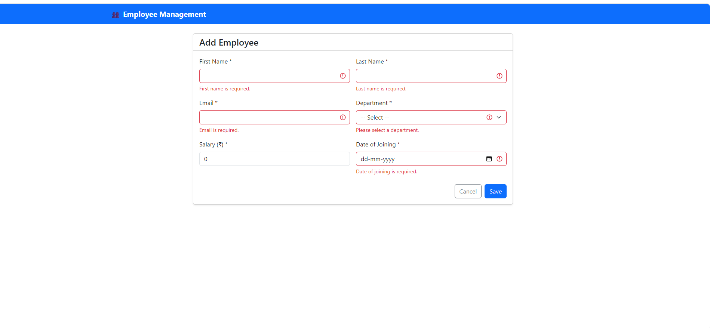
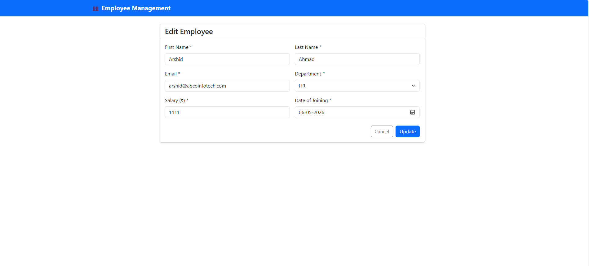
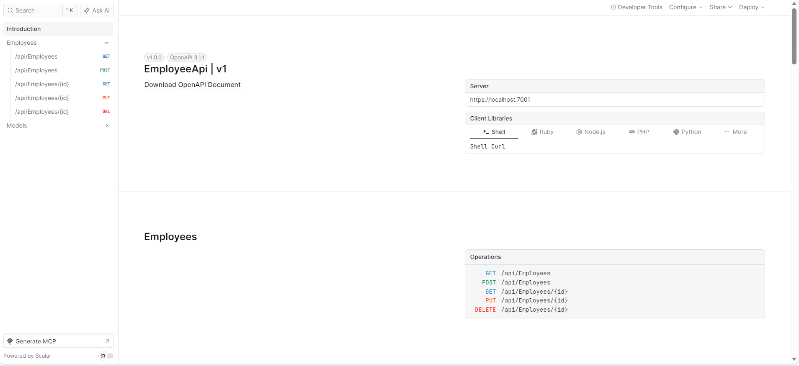
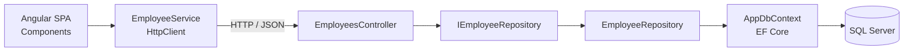

# 👥 Employee Management System

A full-stack **Employee Management System** built with **.NET 10 (ASP.NET Core Web API)**, **Entity Framework Core**, **SQL Server**, and **Angular**. It supports complete **CRUD** operations (Create, Read, Update, Delete) with validation, clean architecture, and a responsive UI.


---

## 📸 Screenshots

### Employee List


### Add Employee


### Form Validation


### Edit Employee


### API Documentation (Scalar / OpenAPI)


---

## ✨ Features

- **Full CRUD** – create, view, update and delete employees
- **RESTful Web API** with proper HTTP status codes (`200`, `201`, `204`, `400`, `404`, `409`)
- **Repository Pattern** with Dependency Injection
- **DTOs** to separate the API contract from database entities
- **Validation on both sides** – Data Annotations in .NET, Reactive Form validators in Angular
- **Duplicate email protection** – unique index in SQL Server + `409 Conflict` handling in the UI
- **EF Core Code-First migrations**
- **Interactive API documentation** with OpenAPI + Scalar
- **CORS** configured for the Angular client
- **Environment-based configuration** (development / production)
- **Loading, error and empty states** in the UI
- **Responsive design** with Bootstrap 5

---

## 🛠️ Tech Stack

| Layer | Technology |
|---|---|
| **Frontend** | Angular (standalone components, signals, zoneless), TypeScript, Reactive Forms, RxJS, Bootstrap 5 |
| **Backend** | .NET 10, ASP.NET Core Web API, C# |
| **ORM** | Entity Framework Core (Code-First, Migrations) |
| **Database** | Microsoft SQL Server |
| **API Docs** | OpenAPI, Scalar |
| **Tools** | Visual Studio 2026, VS Code, SSMS, Git & GitHub |

---

## 🏗️ Architecture



**Request flow:** Angular component → Angular service → ASP.NET Core controller → repository → EF Core → SQL Server

---

## 📁 Project Structure

```
EmployeeManagement/
├── EmployeeApi/                      # Backend (.NET 10 Web API)
│   ├── EmployeeApi.slnx
│   └── EmployeeApi/
│       ├── Controllers/              # API endpoints
│       │   └── EmployeesController.cs
│       ├── Data/                     # EF Core DbContext
│       │   └── AppDbContext.cs
│       ├── DTOs/                     # Request / response models
│       │   ├── EmployeeDto.cs
│       │   └── EmployeeRequestDto.cs
│       ├── Migrations/               # EF Core migrations
│       ├── Models/                   # Database entities
│       │   └── Employee.cs
│       ├── Repositories/             # Data access layer
│       │   ├── IEmployeeRepository.cs
│       │   └── EmployeeRepository.cs
│       ├── appsettings.json
│       └── Program.cs
│
├── employee-ui/                      # Frontend (Angular)
│   └── src/
│       ├── environments/             # API URL per environment
│       └── app/
│           ├── models/               # TypeScript interfaces
│           ├── services/             # API calls (HttpClient)
│           ├── pages/
│           │   ├── employee-list/    # List + delete
│           │   └── employee-form/    # Add + edit (shared form)
│           ├── app.config.ts
│           └── app.routes.ts
│
└── docs/screenshots/
```

---

## 🔌 API Endpoints

Base URL: `https://localhost:7001/api`

| Method | Endpoint | Description | Success |
|---|---|---|---|
| `GET` | `/employees` | Get all employees | `200 OK` |
| `GET` | `/employees/{id}` | Get employee by id | `200 OK` / `404` |
| `POST` | `/employees` | Create an employee | `201 Created` / `409` |
| `PUT` | `/employees/{id}` | Update an employee | `204 No Content` / `404` / `409` |
| `DELETE` | `/employees/{id}` | Delete an employee | `204 No Content` / `404` |

**Sample request body (POST / PUT):**

```json
{
  "firstName": "Arshid",
  "lastName": "Ahmad",
  "email": "arshid@test.com",
  "department": "IT",
  "salary": 75000,
  "dateOfJoining": "2024-06-15"
}
```

---

## 🚀 Getting Started

### Prerequisites

- [.NET 10 SDK](https://dotnet.microsoft.com/download)
- [SQL Server](https://www.microsoft.com/sql-server) (Express or Developer) + SSMS
- [Node.js (LTS)](https://nodejs.org/)
- Angular CLI: `npm install -g @angular/cli`

### 1. Clone the repository

```bash
git clone https://github.com/CodeWith-Arsh/EmployeeManagement.git
cd EmployeeManagement
```

### 2. Set up the backend

1. Open `EmployeeApi/EmployeeApi.slnx` in Visual Studio.
2. Update the connection string in `EmployeeApi/EmployeeApi/appsettings.json` with your SQL Server name:
   ```json
   "DefaultConnection": "Server=localhost\\SQLEXPRESS;Database=EmployeeDb;Trusted_Connection=True;TrustServerCertificate=True;"
   ```
3. Create the database. In **Package Manager Console**:
   ```powershell
   Update-Database
   ```
   or with the .NET CLI:
   ```bash
   dotnet tool install --global dotnet-ef
   dotnet ef database update
   ```
4. Run the API (**F5**). API docs open at `https://localhost:7001/scalar`.

### 3. Set up the frontend

```bash
cd employee-ui
npm install
```

Check the API URL in `src/environments/environment.development.ts`:

```ts
apiUrl: 'https://localhost:7001/api'
```

Start the app:

```bash
ng serve -o
```

The app opens at **http://localhost:4200**.

---

## 🧠 Key Concepts Implemented

**Backend**
- RESTful API design & HTTP status codes
- Dependency Injection & service lifetimes (Scoped)
- Repository Pattern & SOLID principles (SRP, DIP)
- DTOs & model validation with `[ApiController]`
- EF Core Code-First, migrations, Fluent API (unique index), change tracking, `AsNoTracking`
- Async/await for scalable I/O
- CORS & middleware pipeline

**Frontend**
- Standalone components & zoneless change detection with signals
- Service layer with `HttpClient` & RxJS Observables
- Routing with route parameters, redirects and wildcard route
- Reactive Forms with validators & a single component for Add/Edit
- Built-in control flow (`@if`, `@for` with `track`) & pipes
- HTTP error handling mapped to user-friendly messages

---

## 🗺️ Roadmap

- [x] Employee CRUD (API + UI)
- [x] Repository pattern
- [x] Client & server validation
- [ ] Service layer & global exception handling middleware
- [ ] Search, sorting & server-side pagination
- [ ] JWT authentication & role-based authorization
- [ ] Unit tests (xUnit + Moq)
- [ ] Docker / Azure deployment with GitHub Actions CI/CD

---

## 👤 Author

**Arshid Ahmad**
- GitHub: [@CodeWith-Arsh](https://github.com/CodeWith-Arsh)
- LinkedIn: *add your LinkedIn URL here*

---

## 📄 License

This project is licensed under the [MIT License](LICENSE.txt).
